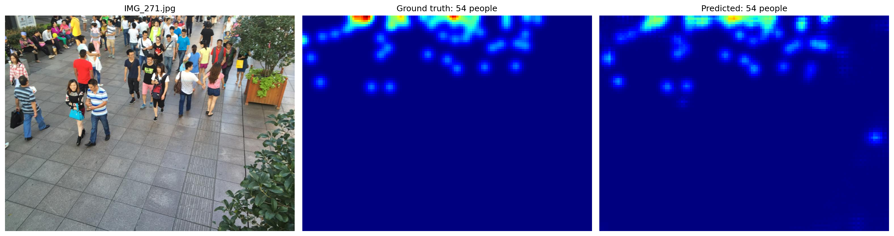
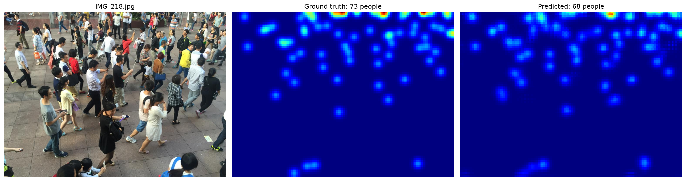
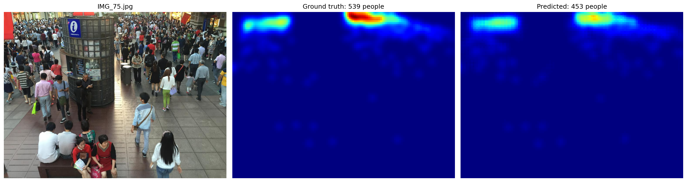

# CrowdSense: Crowd Counting from a Single Photo

A deep learning system that estimates crowd density from images to help prevent overcrowding-related accidents in public spaces.

**Live demo:** LIVE_LINK_COMING_SOON

## What it does

Give CrowdSense one photo of a crowd. It predicts a **density map** (a heatmap that is bright where people are packed together). The **sum of the map is the number of people**. Nobody is detected one by one, so it still works when people overlap.

The demo app also compares the count with a venue capacity, shows a status (Normal / Getting crowded / Overcrowded) and splits the photo into zones to show where the crowd is building up.

## Results

Evaluated on the 316 unseen test photos of ShanghaiTech Part B.

| Method | MAE (lower is better) | RMSE |
|---|---|---|
| Baseline: always guess the average training count (121.3) | 71.53 | - |
| **CrowdSense (this project)** | **9.03** | **14.34** |
| CSRNet paper (for reference, approx.) | 10.6 | 16.0 |

- Total people in the test set: 39,120 true vs 38,458 predicted (about 1.7% under).
- MAE = average number of people the count is off by per photo.
- Values labelled "MSE" in crowd counting papers are really the root of the mean squared error (RMSE).

### Example results

Photo, ground truth and prediction:





## Model

- CSRNet-style network: the first 10 convolution layers of a **pretrained VGG-16** (transfer learning) followed by 6 **dilated convolution** layers and a 1x1 output layer.
- The output density map is 1/8 of the input size.
- Ground truth: a 1 at every head point, Gaussian blur (sigma = 15), downsampled by 8 with sum pooling so the count stays exact.

## Training

| Setting | Value |
|---|---|
| Dataset | ShanghaiTech Part B (400 train + 316 test photos) |
| Split | 360 train / 40 validation (seed 42) |
| Input | Full 768 x 1024 images, batch size 2 |
| Optimiser | Adam, learning rate 1e-5 (x0.1 at epoch 40) |
| Loss | Sum of squared errors on the density map, divided by batch size |
| Epochs | 60 (about 2 h 20 min on an RTX 3050 6 GB laptop GPU) |
| Augmentation | Random horizontal flip |

## Limitations

- It **under-counts very dense crowds** (roughly 250+ people in one view). Examples: IMG_75 true 539 vs 453 predicted, IMG_74 261 vs 201.
- Trained only on ShanghaiTech Part B (street scenes in Shanghai), so it can be less accurate on very different scenes, close-up shots or huge stadium crowds.
- It is a decision aid, not a safety system. Keep a person in the loop.

## Run the demo on your computer

```
git clone https://github.com/visheshjainn16/crowdsense-crowd-counting.git
cd crowdsense-crowd-counting
pip install -r requirements.txt
streamlit run app.py
```

The repository includes `best_model.pth` and a small `sample_data/` folder (15 test photos with ground truth), so the test tabs work without downloading the full dataset.

## Project structure

```
app.py              Streamlit demo app
best_model.pth      Trained model weights
requirements.txt    Packages for the demo app (CPU)
sample_data/        15 sample test photos + density maps
results/            Example result images
history.json        Training history (loss and MAE per epoch)
train.ipynb         Training notebook
explore_data.ipynb  Data exploration and density map notebook
```

## Dataset and references

- Dataset: ShanghaiTech crowd counting dataset, Part B (from Kaggle: `tthien/shanghaitech`). The full dataset is **not** included in this repository.
- Y. Li, X. Zhang, D. Chen. *CSRNet: Dilated Convolutional Neural Networks for Understanding the Highly Congested Scenes.* CVPR 2018.
- Y. Zhang et al. *Single-Image Crowd Counting via Multi-Column Convolutional Neural Network.* CVPR 2016.